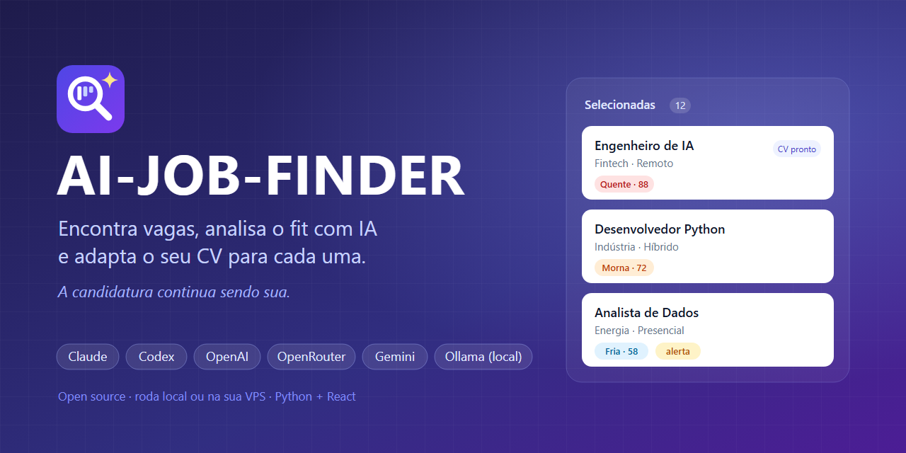
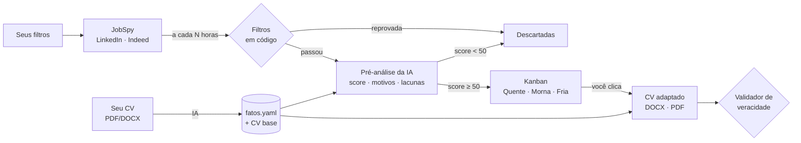

<p align="center">
  
</p>

<p align="center">
  <b>Encontra vagas, analisa o fit com IA e adapta o seu CV para cada uma.</b><br>
  Você escolhe a IA (Claude, Codex, OpenAI, OpenRouter, Gemini ou um modelo local no Ollama) e roda no seu computador ou na sua VPS.
</p>

<p align="center">
  <a href="#começo-rápido">Começo rápido</a> ·
  <a href="docs/provedores-de-ia.md">Escolher a IA</a> ·
  <a href="docs/arquitetura.md">Como funciona por dentro</a> ·
  <a href="AGENTS.md">Para agentes de código</a>
</p>

---

## O que é

O AI-JOB-FINDER é um app open source que faz a parte chata da busca de emprego:

1. **Você sobe o seu CV.** A IA lê, monta um *banco de fatos* (tudo o que é verdade sobre você, com IDs) e reescreve um CV base mais forte. Ela também aponta as correções de maior impacto e pergunta os números que faltam.
2. **Você diz o que procura.** Cargos, cidades, remoto ou não, salário mínimo, o que evitar. Pode escrever em texto livre que a IA preenche o formulário.
3. **O app busca vagas sozinho**, na frequência que você escolher, no LinkedIn e no Indeed (via [JobSpy](https://github.com/speedyapply/JobSpy)).
4. **Cada vaga passa por filtros em código** (de graça) e depois pela **pré-análise da IA**: score de 0 a 100, os 3 motivos de fit, requisito por requisito (forte, parcial, lacuna) e alertas.
5. **As aprovadas caem num kanban** com tag de temperatura: 🔥 Quente (≥ 80), Morna (65 a 79), Fria (50 a 64). As descartadas ficam guardadas com o motivo.
6. **Um clique gera o CV adaptado** para a vaga, em DOCX e PDF, amigável a ATS, com a mensagem para o recrutador e perguntas prováveis de entrevista.

> **A candidatura é sempre sua.** O app não se candidata a nada, não faz login em sites de vaga e não manda mensagem em seu nome.

### Nada inventado no CV

Todo bullet do CV adaptado precisa apontar para um ID do seu banco de fatos. O backend confere a resposta da IA e **remove qualquer bullet sem fonte ou com número que não existe nos seus fatos**. Se você pedir no chat "coloca que eu liderei o time" e isso não estiver nos fatos, a IA pergunta se é verdade em vez de escrever.

## Como funciona



| Parte | Tecnologia |
| --- | --- |
| Backend | Python 3.11+, FastAPI, SQLite (SQLModel), APScheduler |
| Coleta | [python-jobspy](https://github.com/speedyapply/JobSpy) |
| IA | interface única com 9 provedores ([lista](docs/provedores-de-ia.md)) |
| Frontend | React, Vite, TypeScript, Tailwind, dnd-kit |
| CV | python-docx (DOCX) e LibreOffice (PDF) |
| Extra | servidor MCP em `/mcp` para conversar com o seu quadro pelo Claude, Codex ou outro agente |

O "cérebro" da IA mora em [`skills/`](skills): dois arquivos em markdown com o método de diagnóstico de CV e de adaptação por vaga. Quer mudar como a IA avalia ou escreve? Edite esses arquivos; não precisa mexer em código.

## Começo rápido

Você vai precisar de **Git**, **[uv](https://docs.astral.sh/uv/getting-started/installation/)** (gerencia o Python sozinho) e **[Node.js 20+](https://nodejs.org/)**. Ou só de **Docker**.

```bash
git clone https://github.com/XiangBr/ai-job-finder.git
cd ai-job-finder
cp .env.example .env
```

Abra o `.env` e ajuste três coisas:

```ini
SECRET_KEY=qualquer-texto-longo-e-aleatorio
BOOTSTRAP_USERS=seu-usuario:sua-senha
AI_PROVIDER=claude_cli        # ou codex_cli, openai, openrouter, gemini, ollama... (veja abaixo)
```

### Opção A: rodar direto no seu computador

```bash
# 1. front (uma vez, e de novo quando mudar algo em frontend/)
cd frontend && npm install && npm run build && cd ..

# 2. backend
cd backend
uv sync
uv run python -m app.cli check-ai          # testa se a IA escolhida responde
uv run uvicorn app.main:app --port 8000
```

Abra **http://localhost:8000** e entre com o usuário do `BOOTSTRAP_USERS`.

> PDF do CV precisa do LibreOffice instalado (`soffice` no PATH). Sem ele, o download em DOCX e Markdown funciona normalmente.

### Opção B: Docker

```bash
docker compose up -d --build
docker compose exec app python -m app.cli check-ai
```

Abra **http://localhost:8000**. O banco fica no volume `appdata` e sobrevive a rebuilds.

### Primeiro uso

1. Aba **Currículo e filtros → Currículo**: envie o seu CV. Revise a prévia e clique em **Salvar no perfil**.
2. Use o chat **"Converse sobre o seu CV"** para responder as perguntas da IA ("os dashboards são usados por 12 pessoas"). Cada resposta vira um fato confirmado.
3. Aba **Filtros**: descreva o que procura no chat ou preencha o formulário. Clique em **Salvar filtros**.
4. Volte ao **Quadro** e clique em **Buscar agora**. Em alguns minutos as vagas aparecem.
5. Clique num card para ver a pré-análise e **Gerar CV adaptado**.

O app já vem com um perfil fictício ([`exemplos/demo`](exemplos/demo)) para você ver o fluxo antes de subir o seu CV. Para começar do zero, deixe `SEED_PROFILE_DIR` vazio no `.env`.

## Escolher a IA

Troque `AI_PROVIDER` no `.env` e reinicie. Detalhes, custos e modelos sugeridos em **[docs/provedores-de-ia.md](docs/provedores-de-ia.md)**.

| `AI_PROVIDER` | Para quem | O que precisa |
| --- | --- | --- |
| `claude_cli` | Tem assinatura do Claude (Pro/Max) | [Claude Code](https://docs.claude.com/en/docs/claude-code) instalado e logado |
| `codex_cli` | Tem assinatura do ChatGPT (Plus/Pro) | [Codex CLI](https://github.com/openai/codex) instalado e logado (`codex login`) |
| `anthropic` | Prefere pagar por uso | `ANTHROPIC_API_KEY` |
| `openai` | Prefere pagar por uso | `OPENAI_API_KEY` |
| `openrouter` | Quer testar vários modelos com uma chave | `OPENROUTER_API_KEY` |
| `gemini` | Quer usar o Google Gemini | `GEMINI_API_KEY` ([AI Studio](https://aistudio.google.com/apikey)) |
| `ollama` | Quer rodar 100% local e grátis | [Ollama](https://ollama.com) com um modelo baixado |
| `compatible` | LM Studio, Groq, DeepSeek, vLLM... | `AI_BASE_URL` e `AI_API_KEY` |
| `mock` | Só quer ver o app funcionando | nada |

Assinatura em automação: antes de deixar um backend rodando sozinho com a assinatura de um app de IA, confira se os termos do seu plano permitem esse uso. O caminho sem dúvida é uma chave de API.

## Comandos úteis

```bash
cd backend   # (no Docker: docker compose exec app python -m app.cli ...)
uv run python -m app.cli create-user maria                 # cria usuário (gera senha)
uv run python -m app.cli import-cv maria ~/CV.pdf          # sobe o CV pela linha de comando
uv run python -m app.cli set-filters maria filtros.yaml    # troca os filtros
uv run python -m app.cli run maria                         # busca agora
uv run python -m app.cli check-ai                          # testa o provedor de IA
uv run --group dev pytest                                  # testes
```

Cada usuário tem o próprio perfil, filtros, agenda e kanban. Dá para dividir uma instalação com a família ou amigos.

## Conversar com o quadro pelo seu agente (MCP)

Defina `MCP_TOKEN` no `.env` e conecte qualquer cliente MCP em `http://localhost:8000/mcp`:

```bash
claude mcp add --transport http ai-job-finder http://localhost:8000/mcp --header "Authorization: Bearer SEU_MCP_TOKEN"
```

Ferramentas: `board_summary`, `get_job`, `move_card`, `run_search_now`, `search_jobs_live`, `add_job`, `tailor_cv`, `get_settings_info`, `set_schedule`. Exemplo: *"quais vagas quentes chegaram hoje? gera o CV da segunda"*.

## Colocar numa VPS

Resumo (passo a passo em [docs/arquitetura.md](docs/arquitetura.md#deploy-numa-vps)):

1. Na VPS: Docker com compose, um domínio apontando para ela e o `.env` em `/opt/ai-job-finder/.env` com `COOKIE_SECURE=true` e `DOMAIN=seu.dominio`.
2. Do seu PC: `bash deploy/deploy.sh seu-host-ssh`.
3. HTTPS: `docker compose --profile caddy up -d` (Caddy emite o certificado) ou aponte o seu proxy para a porta 8000.

## Limites e boas práticas

- **Volume baixo de propósito.** Cada execução faz no máximo `MAX_SEARCHES_PER_RUN` buscas, com intervalo entre elas. O LinkedIn limita por IP (por volta da 10ª página) e bloqueia IP de nuvem mais rápido; se a VPS passar a voltar 0 vagas, use `JOBSPY_PROXIES` ou rode local.
- **Só dados públicos.** O app lê vagas públicas, sem login.
- **Custo de IA sob controle.** Filtros eliminatórios rodam em código antes da IA, a análise fica em cache por vaga + perfil, e a triagem usa um modelo mais barato que a geração de CV.
- **Gupy** (grande fonte no Brasil) não está no JobSpy: use **+ Vaga manual** e cole a descrição.
- **Seus dados ficam com você.** Banco SQLite local, chaves no `.env`, nada vai para servidor de terceiros além da chamada ao provedor de IA que você escolheu.

## Estrutura

```
ai-job-finder/
├── backend/app/          FastAPI: API, coleta, filtros, pipeline, IA, MCP, CLI
│   └── ai/providers.py   todos os provedores de IA (comece por aqui para adicionar um)
├── frontend/src/         React: kanban, painel da vaga, currículo e filtros
├── skills/               método da IA em markdown (diagnóstico de CV e adaptação por vaga)
├── exemplos/demo/        perfil fictício carregado no primeiro boot
├── docs/                 provedores de IA, arquitetura, logo e banner
├── deploy/               Caddyfile e script de deploy
├── AGENTS.md             guia para agentes de código (Claude Code, Codex, Cursor...)
└── docker-compose.yml
```

## Contribuir

Issues e PRs são bem-vindos. Ideias no backlog: coletor da Gupy, Greenhouse/Lever/Ashby para empresas-alvo, aviso no Telegram, export do perfil. Antes de abrir um PR, rode `uv run --group dev pytest` e leia o [AGENTS.md](AGENTS.md), que tem as regras que o código precisa garantir.

## Licença

[MIT](LICENSE). Use, modifique e compartilhe. Se ele te ajudar a conseguir uma vaga, conta pra gente numa issue.
